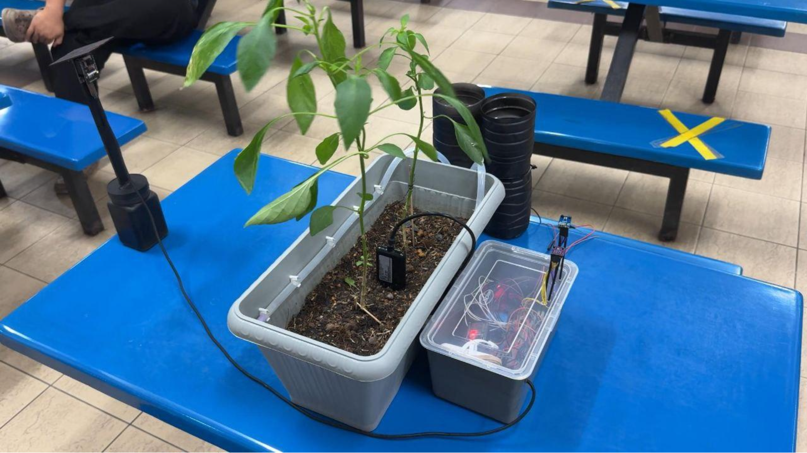
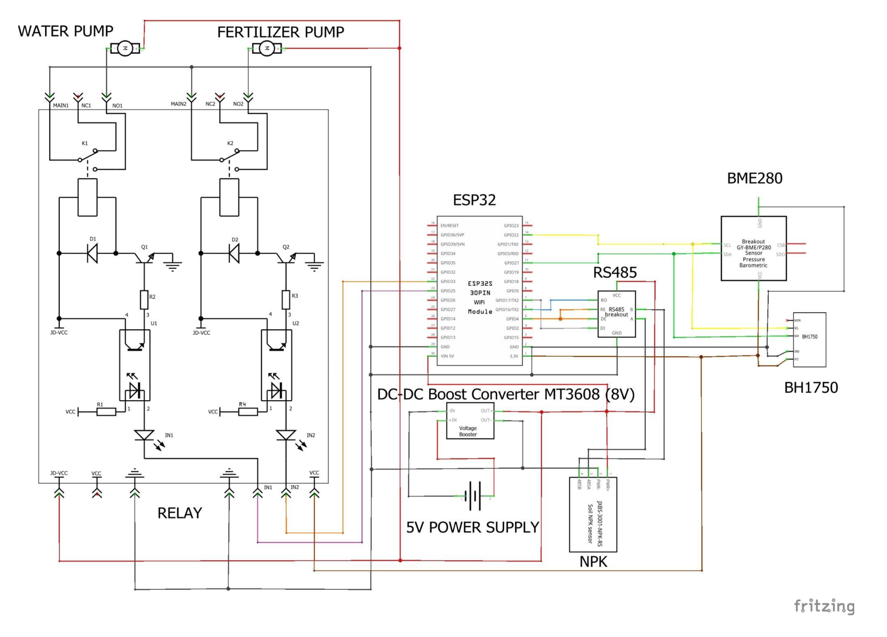

# Smart Chili Cultivation Platform

An IoT platform for chili plants that combines sensor monitoring, automatic irrigation and fertilizing, machine-learning leaf disease detection and a web dashboard.

Built as the Integrated Design Project (IDP) at Universiti Malaysia Perlis (UniMAP), Semester 2, 2024/2025, by a team of four.

**Award:** Bronze Award at the Integrated Design Project Exhibition (IDPEx), 10 July 2025.

> The project was completed in July 2025. This repository was organized and published in November 2026.




## What It Does

- **Monitors the plant's environment:** air temperature, humidity, atmospheric pressure, light intensity, soil moisture, soil temperature, and soil nitrogen, phosphorus and potassium (N, P, K).
- **Waters and fertilizes automatically:** when soil moisture drops below a threshold, the system switches a relay to run a water pump. A second pump supplies AB fertilizer solution.
- **Detects leaf disease:** a user presses a capture button on the dashboard, the ESP32-CAM takes a photo, the Flask backend runs it through a MobileNetV2 model and the result is shown on the dashboard.
- **Shows everything on a web dashboard** with the sensor history stored in a database.

Disease classes: Healthy, Leaf Spot, Leaf Curl, Whitefly and Yellowish.

## System Overview

1. The **ESP32** reads the sensors and sends the readings to the Flask server. It also controls the relay module that switches the pumps.
2. The **Flask server** stores readings in SQLite and serves the dashboard.
3. When capture is requested on the dashboard, the **ESP32-CAM** takes a photo and sends it to the server.
4. The server runs the **TensorFlow Lite model** on the image and returns the diagnosis to the dashboard.

## Hardware

| Component | Purpose |
|---|---|
| ESP32 | Main controller: reads sensors and drives the relays |
| ESP32-CAM | Captures leaf photos on request |
| 5-pin soil transmitter (soil moisture, NPK) with RS485 module | Soil moisture and nutrient readings |
| BME280 | Air temperature, humidity and pressure |
| BH1750 | Light intensity |
| 2-channel relay module | Switches the two pumps |
| 2 pumps | One for water, one for fertilizer |
| MT3608 DC-DC step-up converter | Boosts the voltage for the pumps |
| AB fertilizer solution | Nutrient supply |

### Schematic



## Software

| Part | Technology | Folder |
|---|---|---|
| ESP32 firmware | Arduino framework (C++) | [`firmware/esp32`](./firmware/esp32) |
| ESP32-CAM firmware | Arduino framework (C++) | [`firmware/esp32-cam`](./firmware/esp32-cam) |
| Web server and dashboard | Flask, SQLite | [`server`](./server) |
| Disease detection model | TensorFlow, MobileNetV2, TensorFlow Lite | [`ml`](./ml) |

## Results

### Automatic irrigation test (5 July 2025)

The system was set to start irrigation when soil moisture fell below 30%.

| Time | Event |
|---|---|
| 08:59 | Soil moisture read 28.5%, so the relay switched the water pump on |
| About 20 s | Pump ran, then switched off automatically |
| 09:59 | Soil moisture read 53.1% |

The hourly readings from that day also showed the expected daily patterns: light at 0 lux overnight and peaking in the afternoon, soil temperature between 27.2 and 29.0 °C, and soil moisture between 46.5% and 60.8%.

### Leaf disease model

- Model: MobileNetV2, trained for 30 epochs on a chili leaf image dataset
- Final training accuracy: 91.8%
- Final validation loss: 0.21

## Team and Contributions

| Member | Role |
|---|---|
| **Muhamad Nazrul Hakim** (team leader) | Planned the project and coordinated the team. Built the Flask web dashboard and integrated it with the ESP32, the ESP32-CAM and the ML model. Helped with construction and troubleshooting |
| **Nur Aishah binti Amer Hamzah** | Hardware and ESP32 firmware |
| **Zafri Hazim bin Zulkifli** | Hardware and ESP32 firmware |
| **Nur Lily Mazlin binti Abd Rahman** | Machine learning model (training and evaluation) |

Construction, testing and design were done together as a team.

## Repository Structure

```
smart-chili-cultivation/
├── firmware/
│   ├── esp32/
│   └── esp32-cam/
├── server/            (Flask app)
├── ml/                (notebook, app.py, TensorFlow Lite model)
├── docs/              (connectivity diagram, schematic, photos)
├── .gitignore
├── LICENSE
└── README.md
```

## License

MIT License. See [LICENSE](./LICENSE).